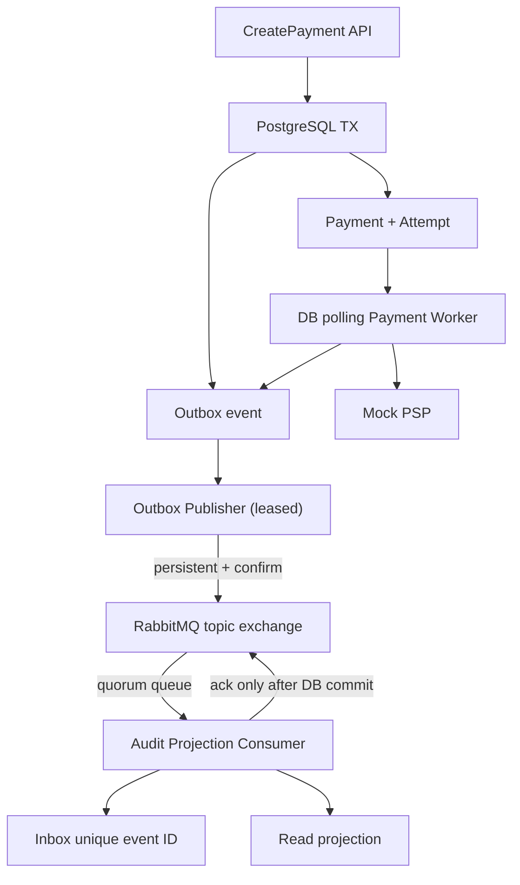

# Messaging Implementation — RabbitMQ Outbox/Inbox v0.2

**Status:** Development-only, awaiting CI and architecture review. No real PSP or bank integration.

## Scope of this increment

- PostgreSQL `messaging.outbox_messages` still committed atomically with Payment state.
- Background Outbox Publisher claims a DB row with a 30-second lease/token.
- Publisher sends persistent messages to RabbitMQ using **publisher confirms + mandatory routing**.
- Only after a broker confirm does the publisher mark the row `published_at`.
- Broker down / nack / unroutable → DB row remains unpublished, retry after delay. Potential duplicates after confirm-before-DB-mark are expected.
- Audit Projection Consumer receives `Payment*` integration events with **manual acknowledgements**.
- In one PostgreSQL transaction, consumer inserts unique `(consumer_name,event_id)` Inbox row and a demo audit read projection.
- Duplicate deliveries return `already_processed`; the consumer still acknowledges.
- Malformed internal messages are rejected and dead-lettered. For transient exceptions, nack/requeue; quorum queue delivery-limit 5 moves repeated failures to DLQ.
- Existing Payment Processing Worker **continues polling PostgreSQL directly** to call Mock PSP; RabbitMQ **does not** invoke any financial side effect. This is intentional until safe PSP idempotency and inquiry are approved.

## Architecture



## Correctness boundaries

**No claim of exactly-once across PostgreSQL and RabbitMQ.** Publisher confirmations are broker acknowledgements, not PSP confirmations, and the broker may deliver a message more than once. Inbox uniqueness + transaction prevents repeat of the **audit projection**, not unintended repeated external charges.

| Crash point | Expected property | Test/evidence |
|---|---|---|
| Before Payment DB commit | No Payment/Outbox half-state | Payment Core database tests |
| After Payment commit, before publishing | Outbox remains retryable | DB lease + publisher |
| After broker confirm, before DB published_at | Event can publish again | Stable event ID + Inbox dedup test |
| After Inbox commit, before RabbitMQ ack | Redelivery receives same event ID | Concurrent duplicate test |
| RabbitMQ down | Payment continues; outbox backlog grows | To be tested via broker fault injection |
| Bad JSON message | No inbox or projection commit, DLQ | Invalid JSON + broker DLQ tests |
| Worker PSP call timed out | Payment Unknown; no blind PSP retry | Existing Payment Core tests |

## Run locally

```bash
cd deploy/compose
cp .env.example .env
# Replace both passwords; do not commit .env
docker compose up --build -d
```

Fresh Postgres volumes apply `001_payment_core.sql` + `002_messaging.sql` automatically.

**Existing Postgres volume:** the init scripts DO NOT re-run. Apply `002` once:

```bash
docker compose exec -T postgres psql -U payment_demo -d payment_demo < postgres-init/002_messaging.sql
```

RabbitMQ Management: `http://localhost:15672`, user `demo`, password from local `.env`. Local-only ports bind to `127.0.0.1`.

### Verify event flow

1. POST Mock payment using the v0.1 local runbook.
2. Watch Worker logs: `docker compose logs -f worker`.
3. Verify outbox and projection using development database:

```sql
SELECT event_type, publish_attempts, published_at, last_publish_error
FROM messaging.outbox_messages ORDER BY occurred_at DESC LIMIT 20;

SELECT consumer_name, event_type, event_id, received_at
FROM messaging.audit_projection ORDER BY received_at DESC LIMIT 20;

SELECT count(*) AS inbox_events FROM messaging.consumer_inbox;
```

4. Stop broker `docker compose stop rabbitmq` and create a new payment: the **Payment DB transaction still commits**, outbox remains unpublished. Restart broker; monitor publisher retry, queue drain and inbox insert.
5. Deliberately redeliver an event with the **same event ID**: the inbox uniqueness constraint keeps one projection.

## Not production-ready

- No real merchant identity; header demo-only.
- No actual PSP status inquiry or authenticated webhook.
- No RabbitMQ-based **payment dispatch** or financial effect from consumer.
- No proven prolonged outage behavior, HA, disaster recovery, alerting/SLO or message schema compatibility.
- Quorum queue delivery-limit=5 is demonstration policy; real retry/DLQ plan requires review, poison-message monitoring and permitted retry semantics.
- Workload impact and broker cost TBD; RabbitMQ topology must be approved in ADR before production.

## Review gates

- Confirm real product need for async RabbitMQ instead of simpler durable DB polling.
- Approve event schema/version, routing keys, domain event vs integration event distinction.
- Approve retry/backoff, dead-letter queue, retention, duplicate-safe consumer contracts.
- Perform broker stop/restart and crash-after-confirm drills with measured evidence.
- **Most importantly**: do not let a RabbitMQ consumer create a new PSP payment from a duplicate message without a provider-side idempotency/status inquiry protocol.
