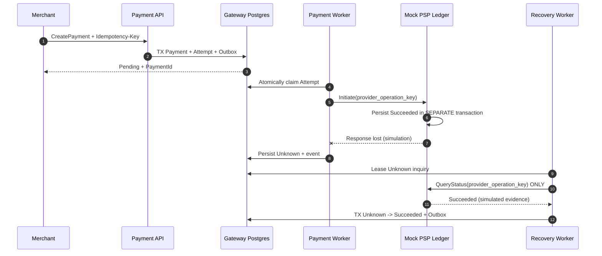

# Payment Recovery & Fault Injection — v0.3

**Status:** Draft, Development-only. **No real PSP integration.** The Payment Orchestration model is a workshop proposal; Finance/PSP/Biz approvals remain open.

## What problem this solves

PSP can commit a financial side effect **before** the network response arrives at the Gateway. After timeout, the Gateway cannot safely say that the payment failed. A retry with a different key or PSP may charge twice.

This increment builds a simulated provider-side ledger, a separate `Unknown` inquiry/recovery path, and fault tests for Outbox publishing failures. The provider ledger intentionally runs inside a separate **database transaction** (same local PostgreSQL server) to illustrate commit-before-response, but does **not** reproduce a true remote bank, its authoritative statement, settlement lag, or network partitions.

## End-to-end simulated flow



## State and coordination rules

| Transition | Required evidence | Safety rule |
|---|---|---|
| Processing → Unknown | Ambiguous provider timeout / expired claim | Do not re-initiate or route to PSP B |
| Unknown → Succeeded | Verified Mock PSP status query reports Succeeded | Payment/Attempt + Outbox in one PG TX |
| Unknown → Failed | Verified Mock PSP status query reports definitive Failed | Never infer no effect from missing record |
| Unknown → Unknown | No provider operation known | Leave Unknown and reschedule inquiry |
| Succeeded → Failed | Stale callback / contradictory event | Not permitted by this recovery worker |

Each inquiry claim has a UUID token and a future retry time. Default max 5 inquiries; after exhaustion, **manual investigation is necessary** (not yet implemented as a business case workflow). A status inquiry does not initiate a new provider charge.

## Fault injection / test matrix

| Test | Stimulus | Expected invariant | Execution |
|---|---|---|---|
| REC-01 | Mock provider commits success, loses response | Gateway Unknown → verified Succeeded, one provider operation | CI automated |
| REC-02 | Timeout before provider effect, no evidence | Stays Unknown; no fabricated Failed | CI automated |
| REC-03 | Same provider idempotency key with contrary request | Original simulated provider effect unchanged | CI automated |
| REC-04 | 12 concurrent attempts to resolve one Unknown | One state transition and one PaymentSucceeded outbox | CI automated |
| MSG-01 | Simulated publisher unavailable, DB still accessible | Outbox not lost; claim can be retried | CI automated |
| MSG-02 | Broker confirmed, app crashes before DB mark | Duplicate delivery same EventId → one Inbox projection | CI automated |
| GAME-01 | Stop RabbitMQ for 5 minutes then restart | Outbox backlog remains, drains with broker recovery | Manual guide; **not yet executed** |
| GAME-02 | Kill worker after Mock PSP ledger commit, before Gateway update | Lease expires → Unknown → inquiry, no reinvocation | Manual guide; **not yet executed** |
| GAME-03 | Repeated poison message → quorum DLQ and safe redrive | Bounded retries, auditable disposition | Manual guide; **not yet executed** |

**Safety scope:** Those tests demonstrate local correctness properties of a mock. They do NOT prove a real PSP has idempotent create, a definitive inquiry endpoint, or no duplicate financial effects across payment networks.

## Local commands

From `deploy/compose`:

```bash
cp .env.example .env
# Replace both passwords. Set MOCK_PSP_OUTCOME=TimeoutAfterSuccess.
docker compose up -d --build
```

For an **existing PostgreSQL volume**, the new init script is not re-applied automatically:

```bash
docker compose exec -T postgres psql -U payment_demo -d payment_demo < postgres-init/003_mock_psp_recovery.sql
```

Submit a demo payment using the existing [Implementation Runbook](../10-implementation/README.md), then inspect:

```sql
SELECT payment_id, state FROM payment.payment_intents ORDER BY created_at DESC LIMIT 10;
SELECT provider_operation_key, outcome FROM mockpsp.provider_operations ORDER BY recorded_at DESC LIMIT 10;
SELECT state, inquiry_count, next_inquiry_at FROM payment.payment_attempts ORDER BY created_at DESC LIMIT 10;
```

The worker should store an initial `PaymentUnknown` event and later a `PaymentSucceeded` event once the Mock PSP inquiry returns the recorded result. Repeat the same Idempotency-Key on `POST /payments` to ensure a duplicate logical request maps to the original PaymentId.

To simulate no provider effect use `MOCK_PSP_OUTCOME=TimeoutBeforeEffect`. The gateway will retain `Unknown` after inconclusive inquiries; it must not invent `Failed`. Neither scenario performs a real bank transaction.

## Game day (manual, not yet executed)

1. Set `MOCK_PSP_OUTCOME=Succeeded`; start Docker Compose.
2. Stop only RabbitMQ: `docker compose stop rabbitmq`.
3. Create several synthetic payments. They commit in PostgreSQL and produce Outbox rows; publisher logs connection errors.
4. Verify `published_at IS NULL` for pending events and that no Mock PSP charge duplication occurs.
5. Restart broker `docker compose start rabbitmq`; inspect Outbox lag and audit projection counts.
6. Record timestamps, event IDs, duplicate counts, broker queue depth, logs, and outcome.
7. Record a game-day evidence link in the project's test register; **do not assume completed because the script exists**.

## Known limitations

- Development-only demo header; not real merchant authentication.
- Fake PSP ledger is on the **same PostgreSQL server**, not remotely isolated.
- Mock query's status has simplified finality; no bank statements, asynchronous VietQR late transfer, or real PSP authentication.
- No controlled operator investigation workflow, real webhook signature verification, or real RefundBudget.
- RabbitMQ queue sizing, DLQ redrive security, RTO/RPO, multi-AZ failure and load-tested capacity remain unverified.
- A repeated unknown inquiry is bounded (5 tries) but no paged operations dashboard / escalation has been implemented.
- No implementation of real-money endpoints permitted before Product/Finance/Legal/PSP contract review.

## Review requests

Approve the status semantics and how read-only inquiry supplies evidence; review technical safety invariants, then decide if recovery needs a dedicated bounded context or belongs to Payment + Provider Integration + Reconciliation. Current design leaves Payment as owner of the state transition and external provider interpretation inside Provider Integration.
